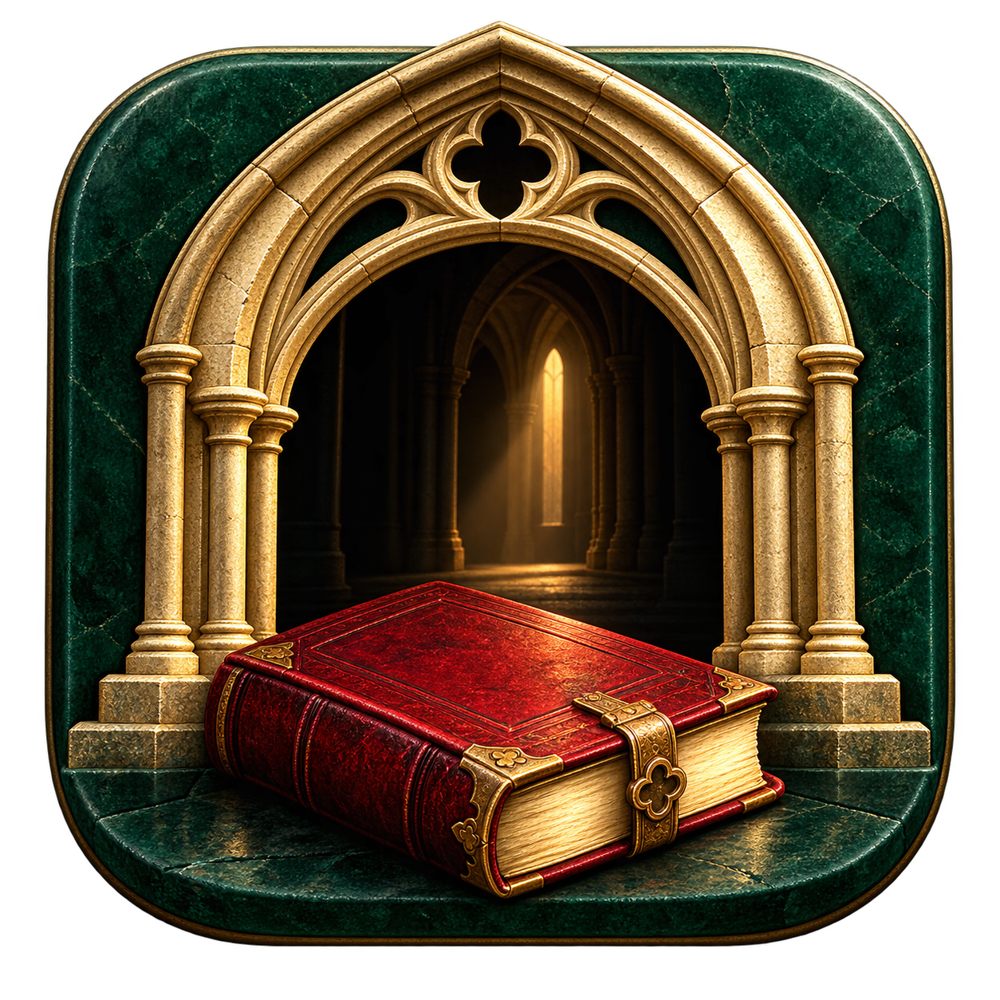
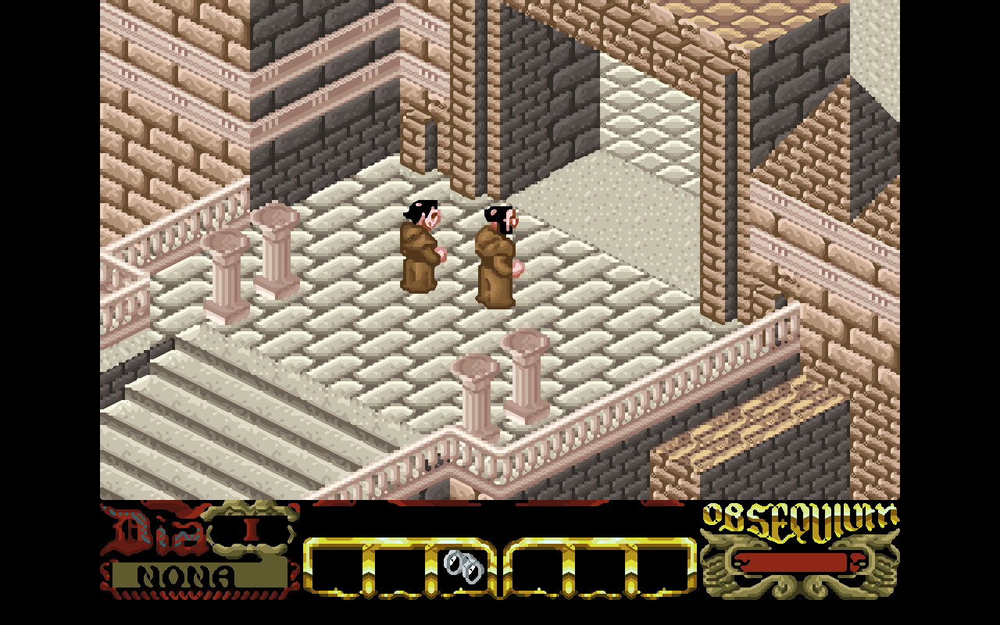

<div align="center">



# La abadía del crimen
### A mystery in seven days. A new home on the Mac.

A native macOS port of the 1987 adventure by **Paco Menéndez and Juan Delcán**.


[](https://github.com/pballada/abadia/actions/workflows/macos.yml)

[Get started](#build-and-run) · [Game data](#import-game-data) · [Controls](#play) · [Development](#development) · [Credits](#source-and-attribution)



*Seven days. An isolated abbey. A secret hidden among its books.*

</div>

## The original adventure, thoughtfully presented

Explore the abbey as Guillermo, accompanied by Adso, and investigate a series of mysterious deaths. The monks follow their own routines; your investigation must fit around the abbey’s services, meals, and restrictions.

This port runs the reconstructed C++ game directly inside a native AppKit application. Core Graphics draws the scene, AVFoundation plays audio, and Apple’s GameController framework handles controllers. The app runs locally using system frameworks.

- **Enhanced graphics:** two edge-aware Scale2x passes soften diagonal stair steps while retaining the original colors and artwork. Choose **View → Original Pixels** whenever you prefer the unfiltered frame.
- **A calmer presentation:** a dark green surround, fine brass frame, restrained control hints, and a pause card over the frozen scene.
- **Mac controls:** native menus, fullscreen, screenshot export, keyboard shortcuts, automatic pause when switching apps, and buffered quick key taps.
- **Keep your progress:** seven in-game save slots, with data and preferences stored in Application Support.
- **Universal app:** builds for Apple Silicon and Intel from the same source tree, targeting macOS 13 and later.

<table>
<tr><th>Original Pixels</th><th>Enhanced Graphics · default</th></tr>
<tr>
<td></td>
<td></td>
</tr>
</table>

The enhanced mode refines the existing pixel art; it does not replace the sprites or environments with newly drawn assets. Screenshots show artwork from the separately imported game data, credited below.

## Build and run

Install Xcode or Apple's Command Line Tools, then:

```sh
make -j8
open "build/La abadia del crimen.app"
```

`make universal` builds both `arm64` and `x86_64`. `make package` creates `build/Abadia-macOS-universal.zip`. Builds are ad-hoc signed for local use; they are not Developer ID signed or notarized. You can open the folder in Xcode for source editing; the reproducible build entry point is the Makefile.

## Import game data

On first launch, choose **Import Game Data…** and select your Abbey folder, its `build` folder, or `roms/abadia`. The importer searches these supported locations for:

| File | Required size |
| --- | ---: |
| `abadia.dsk` | 160,768 bytes |
| `GraficosCPC` | 174,065 bytes |
| `GraficosVGA` | 174,065 bytes |

This version supports the unchanged data layout used by [Samuel85/Abbey](https://github.com/Samuel85/Abbey/tree/048c3141f0bd1772c8b0bba82d18ebc72d837be1/build/roms/abadia). A disk image alone is insufficient: the reconstructed renderer also needs both graphics packs. SHA-256 checks reject unsupported or corrupt files before the legacy engine runs. No game assets are included in this repository or the packaged app. Supply a data copy you are entitled to use.

Optional WAV files in the same folder provide music and effects: `inicio`, `final`, `fondo`, `abrir`, `aporrear`, `campanas`, `cerrar`, `coger`, `dejar`, `espejo`, `pasos`, and `tintineo` (each with `.wav`). Without them the game runs silently.

Data is copied locally to `~/Library/Application Support/Abadia/roms/abadia`. Saves and language settings live in `~/Library/Application Support/Abadia`. The application bundle stays read-only. Nothing is uploaded, and the app makes no network requests.

## What’s new in 0.2

- A first-launch guide explains character-relative movement, your arrival at the abbey, saves, and pause. Reopen it with **Help → Getting Started**.
- The importer recognizes the Abbey project folder as well as the data folder itself.
- Save slots are replaced atomically and carry an integrity checksum. Corrupt or empty slots are rejected before changing the current world; failed writes preserve the previous slot.
- Confirmation presses are buffered once, so holding Return or controller A cannot confirm the next screen accidentally.

**Save compatibility:** 0.2 adds an integrity footer. Unsealed saves from 0.1 or other ports are retained on disk but cannot be loaded by 0.2. Keep the earlier app if you need to continue those saves; back up Application Support before overwriting a slot. The checksum detects accidental damage, not maliciously crafted files.

## Play

Press Return on the title screen, choose a new game, and press Return to skip the prologue if desired. Follow the abbot when you arrive. Observe the abbey's daily schedule and protect your obsequium.

| Action | Keyboard | Controller |
| --- | --- | --- |
| Walk forward | ↑ / W | D-pad up / left stick up |
| Turn | ← → / A D | D-pad / left stick left or right |
| Command Adso | ↓ / S | D-pad down / left stick down |
| Accept / skip prologue | Return | A |
| No / secondary action | N / C | B |
| Drop object | Space | X |
| Alternate action | Z | Y |
| Game menu | Escape / ⌘M / 2 | Menu |
| Pause / resume | P / ⌘P | — |
| Fullscreen | ⌃⌘F | — |
| Mute | ⌘U | — |
| Screenshot | ⌘S | — |

The in-game menu provides new game, seven save slots, load, language selection, and continue. Spanish is the default; the upstream translations are retained. Movement follows the original turn-and-walk controls, not screen-relative movement. Quick taps are buffered until the next simulation tick. Switching apps automatically pauses play; resume explicitly with P.

## Development

```text
Sources/
  Core/          Reconstructed game logic, rendering, characters, and save system
  Platform/      Native window, input, audio, asset import, and presentation
Resources/       App metadata and original macOS icon
scripts/         Icon generation and repository publishing
.github/         Universal macOS build workflow
```

The [port architecture](docs/PORTING.md) explains the native integration and inherited fixes. The [verification notes](docs/VERIFICATION.md) record what has actually been checked. To contribute, describe the visible problem, keep changes focused, and include build or gameplay evidence appropriate to your change. Please keep ROMs, graphics packs, audio, and personal saves out of commits.

## Verification

```sh
make test
"build/La abadia del crimen.app/Contents/MacOS/Abadia" \
  --smoke-test /absolute/path/to/roms/abadia /tmp/abadia-gameplay.png

make -j8 CONFIG=sanitize
ASAN_OPTIONS=detect_leaks=0 UBSAN_OPTIONS=halt_on_error=1 \
  build/obj-arm64-sanitize/Abadia --smoke-test /absolute/path/to/roms/abadia
```

The asset-free tests reject missing, truncated, and corrupt imports without changing the destination. The optional real-data test uses an isolated temporary save directory and exercises the title, menu, prologue, gameplay, player turning, saving, restoring changed player coordinates, all seven save slots, rejection of corrupt and empty slots, a failed overwrite, and hundreds of subsequent simulation ticks. It never alters normal player saves. Game data is not downloaded by CI.

This is an initial playable port, not a claim that every puzzle and ending has been exhaustively replayed. Hardware controller mapping is implemented with Apple's GameController API; actual controller hardware testing remains outstanding. The renderer uses the upstream VGA artwork, with Enhanced Graphics and Original Pixels presentation options. A CPC/VGA artwork switch is not exposed. Legacy saves from other ports are not a supported interchange format.

## Source and attribution

The game reconstruction comes from [Abbey](https://github.com/Samuel85/Abbey), pinned to commit `048c3141f0bd1772c8b0bba82d18ebc72d837be1`, building on **Manuel Abadía's VIGASOCO** and the SDL adaptation by **Luzbel**. Abbey's modernized implementation is by **Samuel Salinas Almaguer**, with contributions including **Emilio Moretti**. Remake graphics are credited upstream to **Antonio Giner**. Original game design/programming: **Paco Menéndez**; original artwork: **Juan Delcán**.

The original license is preserved verbatim in [Sources/Core/readme.txt](Sources/Core/readme.txt). It permits noncommercial derivatives with attribution and forbids selling VIGASOCO or distributing it with ROM images. This project is a derivative port, not an official VIGASOCO release. See [LICENSE.md](LICENSE.md) and [PORTING.md](docs/PORTING.md).
