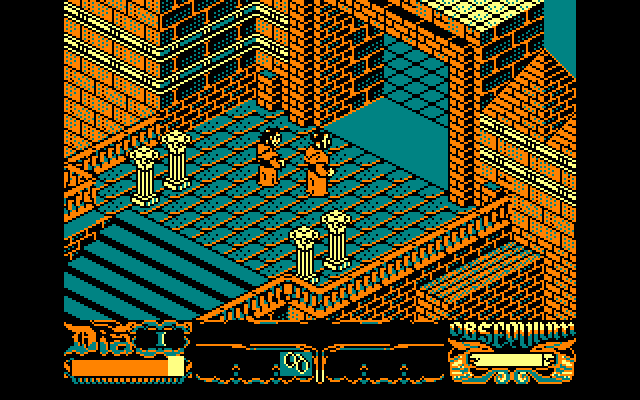

<div align="center">


# La abadía del crimen
### A mystery in seven days. A new home on the Mac.

A native macOS version of the 1987 adventure by **Paco Menéndez and Juan Delcán**.

[](https://github.com/pballada/abadia/releases/latest)
[](https://github.com/pballada/abadia/releases)
[](https://github.com/pballada/abadia/actions/workflows/macos.yml)
<br>


[](LICENSE.md)
[](https://github.com/pballada/abadia/stargazers)

### [⬇︎ Download for Mac](https://github.com/pballada/abadia/releases/latest/download/Abadia-macOS.zip)

[Install](#install) · [Graphics](#two-ways-to-see-the-abbey) · [Controls](#play) · [Development](#development) · [Credits](#credits-and-license)

 

*Left: 256-colour remake graphics. Right: the original 1987 Amstrad CPC look, one menu click away.*

</div>

<details>
<summary><b>🇪🇸 En español</b></summary>

Versión nativa para Mac del clásico de 1987 de **Paco Menéndez y Juan Delcán**, inspirado en *El nombre de la rosa*.

1. **[Descarga la app](https://github.com/pballada/abadia/releases/latest/download/Abadia-macOS.zip)** y abre el ZIP.
2. Arrastra **La abadia del crimen** a **Aplicaciones** y ábrela.
3. Pulsa **Download Game Data**. La app descarga los datos originales del juego (unos 6 MB) desde el [proyecto Abbey](https://github.com/Samuel85/Abbey) y comprueba cada archivo.

Funciona en Mac con Apple Silicon e Intel con macOS 13 o posterior. Está firmada y notarizada por Apple, y se actualiza sola. Con **View → Original Amstrad Graphics** (⌘G) cambias entre los gráficos remasterizados de 256 colores y los originales del Amstrad CPC. El juego está en castellano por defecto. Se controla con el teclado (flechas o WASD) o con un mando.

Si te gusta, ¡dale una ⭐ al repositorio!

</details>

## Install

1. **[Download the app](https://github.com/pballada/abadia/releases/latest/download/Abadia-macOS.zip)** and open the ZIP.
2. Drag **La abadia del crimen** into your **Applications** folder and open it.
3. Click **Download Game Data**.

That's it. The app fetches the original game data (about 6 MB) from the [Abbey project](https://github.com/Samuel85/Abbey/tree/048c3141f0bd1772c8b0bba82d18ebc72d837be1/build/roms/abadia), checks every file against a known SHA-256 checksum, and starts the game. The app is signed with Developer ID and notarized by Apple. It runs natively on Apple Silicon and Intel Macs with macOS 13 or later.

**Updates install themselves.** The app checks GitHub for a new release once a day and offers to install it. It verifies Apple's signature and the release team before replacing itself, then relaunches. Your game data and saves are kept. Use **Abadía → Check for Updates…** to check now, or turn off automatic checks in the same menu. Updates can only install in place when the app is in a folder you can write to, such as Applications.

<details>
<summary>Already have the game files, or prefer to get them yourself?</summary>

Click **Use a Folder…** instead and choose a folder containing these files. It can be an Abbey checkout, its `build` folder or `roms/abadia`.

| File | Size | Required |
| --- | ---: | :---: |
| `abadia.dsk` | 160,768 bytes | ✓ |
| `GraficosCPC` | 174,065 bytes | ✓ |
| `GraficosVGA` | 174,065 bytes | ✓ |
| `inicio.wav`, `final.wav`, `fondo.wav` (music) | | optional |
| `abrir`, `aporrear`, `campanas`, `cerrar`, `coger`, `dejar`, `espejo`, `pasos`, `tintineo` (`.wav` effects) | | optional |

Download them individually from [Samuel85/Abbey › build/roms/abadia](https://github.com/Samuel85/Abbey/tree/048c3141f0bd1772c8b0bba82d18ebc72d837be1/build/roms/abadia). Only these exact versions are accepted; the checksums are in [`Sources/Platform/Assets.mm`](Sources/Platform/Assets.mm). Without the WAV files the game runs silently.

To replace the data later, for example to add missing audio, quit the app and reopen it while holding **Option**.

</details>

<details>
<summary>Where your data lives, and what the app connects to</summary>

The game data and seven save slots are stored in `~/Library/Application Support/Abadia`; **File → Show Saves in Finder** opens that folder. Deleting the app keeps it.

The app makes network requests only to GitHub: when you click **Download Game Data**, and when it checks for and downloads updates. Nothing about you or your games is uploaded.

To verify a download by hand, put `SHA256SUMS.txt` from the [release page](https://github.com/pballada/abadia/releases/latest) next to the ZIP and run `shasum -a 256 -c SHA256SUMS.txt`.

</details>

## Two ways to see the abbey

**View → Original Amstrad Graphics** (⌘G) switches between:

- **Remake graphics** (default): Antonio Giner's 256-colour redraw of the sprites and stonework, the same as Abbey and VIGASOCO.
- **Original Amstrad graphics**: the four-colour palette and art of the 1987 Amstrad CPC release.

You can switch at any time, even mid-game. Your choice is remembered.

The picture always keeps the original 8:5 proportions and fills the window. At any window size, every game pixel is drawn the same size. Sizes that aren't a whole multiple are scaled with *sharp bilinear*: the image is enlarged by a whole number using nearest neighbour, then resampled once. Pixels stay crisp, without the uneven columns plain nearest-neighbour scaling produces. For exact whole-number scaling with black borders, turn on **View → Pixel-Perfect Scaling**. **View → Original Size** and **Double Size** (⌘1 and ⌘2) give exact sizes.

Music and effects play at their native sample rate through AVFoundation, and they're loaded at startup so the first effect plays without delay.

## Play

Press Return on the title, choose a new game, and press Return again to skip the prologue. When you arrive, follow the abbot. Attend services and meals, and protect your *obsequium*.

| Action | Keyboard | Controller |
| --- | --- | --- |
| Walk forward | ↑ / W | D-pad up / left stick up |
| Turn | ← → / A D | D-pad / left stick left or right |
| Command Adso | ↓ / S | D-pad down / left stick down |
| Accept / skip prologue | Return | A |
| No / secondary action | N / C | B |
| Drop object | Space | X |
| Alternate action | Z | Y |
| Game menu (new game, save, load, language) | Escape / ⌘M / 2 | Menu |
| Pause / resume | P / ⌘P | — |
| Original Amstrad graphics | ⌘G | — |
| Fullscreen | ⌃⌘F | — |
| Mute | ⌘U | — |
| Screenshot | ⌘S | — |

The controls turn Guillermo and walk him forward, as in the original; they aren't screen-relative. Switching to another app pauses the game. Spanish is the default language; the in-game menu also offers the other translations from Abbey.

## How this relates to Abbey

The game itself is the C++ reconstruction from VIGASOCO, as adapted by [Samuel85/Abbey](https://github.com/Samuel85/Abbey). `Sources/Core` is Abbey's engine with small fixes. This project replaces Abbey's SDL front end with native macOS code:

- AppKit for the window, menus and fullscreen
- Core Graphics for drawing
- AVFoundation for audio
- GameController for gamepads
- An importer and downloader that check every file
- Crash-safe saves with integrity checks
- A self-updater

The changes to inherited code are listed in [docs/PORTING.md](docs/PORTING.md). They include a fix for a pathfinding crash and a save serializer fix.

## Development

You need Xcode or the Command Line Tools.

```sh
make -j8 && open "build/La abadia del crimen.app"   # build and run (ad-hoc signed)
make universal                                      # Apple Silicon + Intel
make test                                           # asset-free tests
```

```text
Sources/Core/      Reconstructed game logic and renderer (VIGASOCO / Abbey)
Sources/Platform/  Native window, input, audio, scaling, data download, saves, updater
Tests/             Audio playback and pathfinding regressions
Resources/         Info.plist and icon
scripts/           Signed release, icon generation, publishing
```

More checks:

```sh
"build/La abadia del crimen.app/Contents/MacOS/Abadia" --download-test     # downloads and verifies the data pack
"build/La abadia del crimen.app/Contents/MacOS/Abadia" \
  --smoke-test /path/to/roms/abadia /tmp/abadia.png                        # plays through menus, saves, both graphics sets
make -j8 CONFIG=sanitize                                                   # AddressSanitizer + UBSan build
```

The smoke test uses a temporary save folder and never touches your real saves. Releases are built, signed, notarized and published with `scripts/release.sh`; see [docs/RELEASING.md](docs/RELEASING.md). The auto-updater looks for a GitHub release tagged `vX.Y.Z` with an `Abadia-macOS.zip` asset. What has been tested is recorded in [docs/VERIFICATION.md](docs/VERIFICATION.md).

Contributions are welcome. Describe the visible problem, keep changes focused, and include evidence that the fix works. Keep disk images, graphics packs, audio and personal saves out of commits.

## Credits and license

- Original game: **Paco Menéndez and Juan Delcán**, Opera Soft (1987).
- C++ reconstruction: Manuel Abadía and the VIGASOCO Project Team (2003–2005).
- SDL adaptation: Luzbel. Remake graphics: Antonio Giner.
- Abbey: Samuel Salinas Almaguer and contributors, including Emilio Moretti.
- Native macOS version: pballada (2026).

This is a **noncommercial** preservation project. The inherited code remains under the VIGASOCO terms in [Sources/Core/readme.txt](Sources/Core/readme.txt); see [LICENSE.md](LICENSE.md). The app and this repository contain no game data. The disk image, graphics and audio belong to their respective rights holders. The app downloads them from the Abbey project only when you ask it to.
